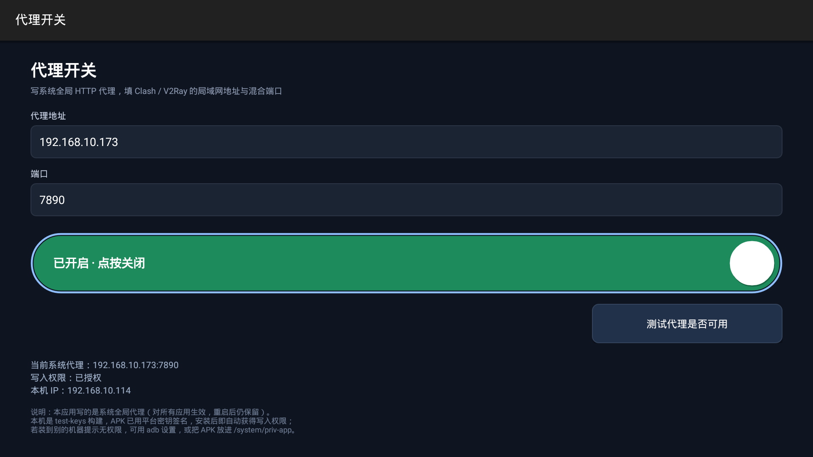
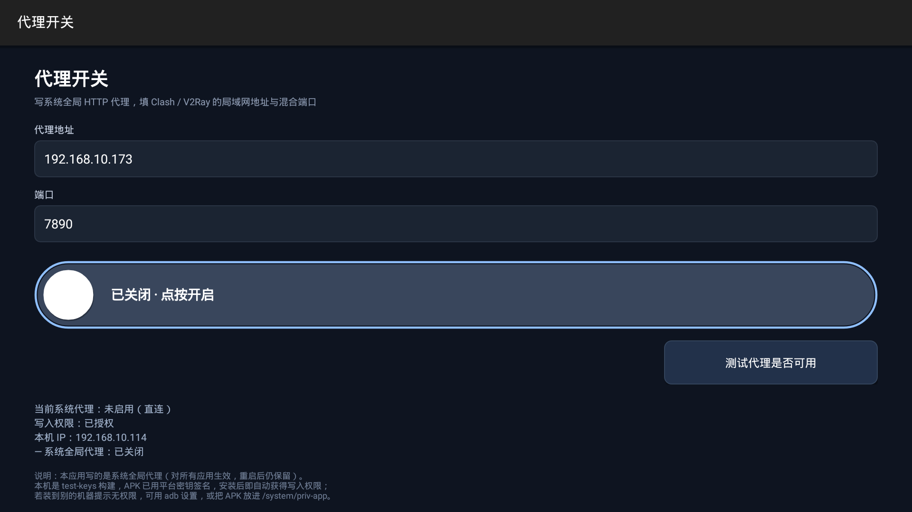
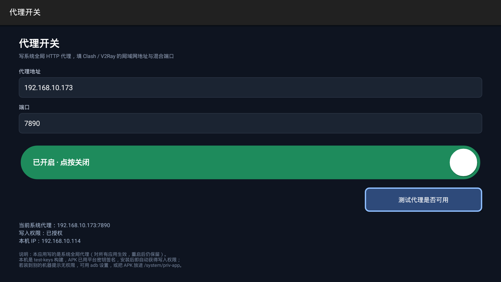

# JIMI-proxy（代理开关 / ProxySwitch）

给没有代理设置界面的 Android TV / 智能投影仪用的系统全局 HTTP 代理开关。

最初是为了极米 H1S（XGIMI TV，Android 5.1.1 / SDK 22 / armeabi-v7a）做的：它系统设置里根本没有"代理服务器"这一项，而局域网里跑着 Clash Meta（mihomo），想让投影仪上的 YouTube / SmartTube 也走代理。

一个开关就能开/关系统全局代理，能改代理地址和端口，还带一个"测试代理是否可用"按钮。因为要面向遥控器操作，所有可交互元素都有明显的焦点高亮。



## 它做了什么

本质上就是一句 `settings put global http_proxy host:port`（关闭时写 `:0`），只是把它做成了可视化的 App：

- 写的是 `Settings.Global` 的 `http_proxy`，也就是**系统全局代理**，对所有应用的 HTTP/HTTPS 请求生效，重启后依然保留（所以别用它替代 Clash 的 TUN 模式，它只管 HTTP 代理协议）。
- **开关状态不来自本地变量**：每次切换、每次回到前台都会重新 `getString` 读一次 `http_proxy`，所以绿色/灰色显示的是系统真实状态，用 adb 改了它也会跟着变。
- 「测试」按钮用原始 socket 发 `CONNECT www.gstatic.com:443`，判断返回里有没有 ` 200`，能确认代理链路真的通。
- 主路径写失败时，会退一步尝试写 WiFi 网络的静态代理（`WifiManager.updateNetwork` + 反射 `ProxyInfo`），作为兜底。

## 权限（关键，不解决这个就用不了）

写 `Settings.Global.http_proxy` 需要签名级权限，普通安装的 APK 必然 `SecurityException`。三个选择：

1. **平台密钥签名**（本项目做法）：`ro.build.tags=test-keys` 的设备可用设备自己的 platform key 签名后直接安装；注意厂商经常另生成一套 platform key，**AOSP 公共 testkey 并不通用**（本项目 `platform-keys/` 里的就是 AOSP testkey，在极米这台机器上是失效的，仅作构建示例）。
2. **塞进 `/system/priv-app`**：`adb root` 可用（`ro.debuggable=1`）时，
   ```
   adb push ProxySwitch.apk /system/priv-app/ProxySwitch.apk
   adb shell chmod 644 /system/priv-app/ProxySwitch.apk
   adb shell chown root:root /system/priv-app/ProxySwitch.apk
   adb shell chcon u:object_r:system_file:s0 /system/priv-app/ProxySwitch.apk
   adb shell sync; adb shell reboot
   ```
   之后应用即被当作特权应用，权限自动授予；后续升级 `adb install -r` 即可，不必再改 /system。
3. **干脆用 adb 设置**：不装 App 也能用，只是每次要开电脑。
   ```
   adb shell settings put global http_proxy 192.168.10.173:7890
   adb shell settings put global http_proxy :0      # 关闭
   ```

Manifest 里需要的权限（缺一不可）：

| 权限 | 作用 |
| --- | --- |
| `WRITE_SECURE_SETTINGS` | 写 `Settings.Global` 的名义权限 |
| `WRITE_SETTINGS` | **这台 ROM 真正校的就是它**：极米 5.1 的 SettingsProvider 对 `http_proxy` 要求 `WRITE_SETTINGS`（`signature|preinstalled`），只给前者会报 `Permission denial: writing to settings requires android.permission.WRITE_SETTINGS` |
| `INTERNET` / `ACCESS_NETWORK_STATE` | 测试按钮、读本机 IP |
| `ACCESS_WIFI_STATE` / `CHANGE_WIFI_STATE` | 兜底的 WiFi 静态代理 |

## 界面

- 一个开关（自绘 View，`ToggleSwitchView`）：绿色 + 滑块靠右 = 已开启，石板灰 + 滑块靠左 = 已关闭，文字同步显示状态；按下即切换。
- 遥控器焦点高亮：开关外圈 3dp 亮蓝描边，测试按钮描边 + 底色提亮，输入框 2dp 描边；进入 App 焦点默认在开关上，不会顶出输入法。




## 构建

无 Gradle，纯 build-tools 手工链（`aapt2` → `javac` → `d8` → `zipalign` → `apksigner`）：

```powershell
# 需要：build-tools 35.0.0、platforms/android-31、JDK 17（JAVA_HOME）
# 三个参数都可省：-VersionName、-VersionCode、-OutFile
.\build.ps1
.\build.ps1 -VersionName 1.2.0 -VersionCode 5 -OutFile .\dist\ProxySwitch-1.2.0.apk
# 输出 BUILD OK <bytes>  ->  <path>
```

`SDK` 位置从 `ANDROID_SDK_ROOT` / `ANDROID_HOME` 取，都没有才退回本机的 `%LOCALAPPDATA%\Android\Sdk`。版本号是**改清单副本**注入的——`aapt2 link` 的 `--version-code` 只在清单没声明时生效，而这份清单里写了，所以脚本会先复制一份 `AndroidManifest.xml` 改掉 `versionCode/versionName` 再链接。

要换签名就把 `platform-keys/testkey.pk8`、`testkey.x509.pem` 替换成设备真正的 platform key。

### 自动构建 / 发布（GitHub Actions）

`.github/workflows/build-apk.yml`，跑在 `windows-latest`，流程就是上面的手工链，额外做了版本号注入和签名校验。

| 触发 | 行为 |
| --- | --- |
| push 到 `main` | 构建，APK 作为 Actions artifact（保留 90 天），不发 Release |
| 打 `v*` 标签（如 `v1.0.0`） | 构建 + 自动创建 Release，把 `ProxySwitch-<版本>.apk` 挂上去，并自动生成 release notes |
| Actions 页面手动触发 | 只构建，不发布 |

```powershell
git tag v1.0.0
git push origin v1.0.0     # 打完标签就会自动出 Release
```

标签名去掉前面的 `v` 就是 `versionName`，`versionCode` 取 workflow 的 `run_number`（单调整数，够升级用）。想完全不靠标签也可以手动跑一次 workflow。

## 目录

```
AndroidManifest.xml          包名 com.robin.proxyswitch，minSdk 21 / targetSdk 22
build.ps1                    手工构建脚本
src/com/robin/proxyswitch/MainActivity.java      主逻辑（写代理、测试、状态刷新）
src/com/robin/proxyswitch/ToggleSwitchView.java  自绘开关（状态色 + 焦点描边）
res/layout/activity_main.xml                     界面
res/drawable/edit_bg.xml, btn_bg.xml             输入框 / 按钮的焦点态 selector
platform-keys/               AOSP testkey（示例用，非通用）
screenshots/                 实机截图
ProxySwitch.apk              已构建产物（1.0）
```

## 已验证环境

| 项 | 值 |
| --- | --- |
| 设备 | 极米 H1S（XGIMI TV，MStar 芯片，Android 5.1.1，1920x1080） |
| 代理端 | Android 手机跑 Clash Meta (CMFA, mihomo)，`allow-lan: true`，`mixed-port: 7890` |
| 结果 | 开关切换后 `http_proxy` 在 `192.168.10.173:7890` 与 `:0` 之间正确变化；测试返回 `HTTP/1.1 200 Connection established`；SmartTube 首页正常加载 |

> DNS 提醒：如果代理端 Clash 的 nameserver 是明文 UDP，被污染后即使代理通了 YouTube 也会黑屏/超时。把 nameserver 换成 DoH（例如 `https://1.1.1.1/dns-query`）再试。
